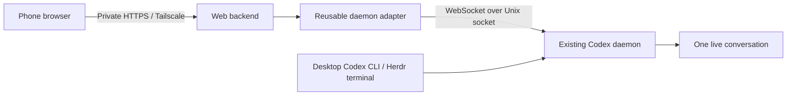

# Codex Pocket — product and technical specification

Status: working web application with authenticated private phone access.
Phone messaging, screenshot input, active async replies, and custom Home Screen
icon have been exercised; remaining limitations are listed in README.md.
User clarification: one device submits at a time; observed-idle send is sufficient.
App name: Codex Pocket. Audience: one person using their own Linux dev machine.

## 1. Problem and outcome

A developer codes in Codex CLI at his desk, sometimes hosted by Herdr, then wants to
pick up his phone, review the same conversation, send an instruction, and return
to the desktop CLI without losing context or encountering an ownership lock.

Termius + SSH + `codex resume` already works. This project is a better mobile
interface, not a replacement coding agent, terminal multiplexer, or orchestration
system. Keep that working fallback available throughout development.

**Success:** desktop CLI and mobile web UI remain connected to the same daemon
thread; sequential messages from either are visible in both, and mobile
disconnect does not stop work or prevent the desktop's next message.

## 2. Decisions and scope

### Fixed constraints

- Standalone repository and application; no changes to OpenClaw source/config.
- Reuse the human CLI's existing managed Codex app-server daemon and login.
- No private app-server startup, transcript copying/adoption, or alternate model
  API as a hidden fallback. No API keys, new paid services, or hosted inference.
- Browser reaches a local backend; only the backend connects to the Unix socket.
- Submitted text goes unchanged to Codex. No intermediary LLM.
- Private access via the user's Tailscale network, not a public internet service.
- One user and one host in MVP. Daemon adapter remains reusable independently.

### MVP

1. Connection/status screen with explicit unavailable/incompatible states.
2. List conversations already loaded in the chosen daemon; title, project/cwd,
   activity state, and recency when available. Do not silently resume unloaded IDs.
3. Select a conversation and read bounded, paginated history.
4. Stream new user messages, assistant text, and activity from that thread.
5. Send exact-text idle messages or explicit follow-ups to the displayed active turn.
6. Preserve desktop usability while attached and after disconnect.
7. Handle mobile backgrounding and reconnect without silent duplicate writes.
8. Show blocked approval/question states and direct the user to CLI in initial
   MVP; do not auto-answer. Represent tool activity readably without full terminal
   emulation. No claim of complete mobile operation when a required action
   still needs the desktop.

### Explicitly deferred

- New conversation creation and browsing/restoring archived sessions.
- Answering blocking approval/question server requests from the browser.
- Queue management and interrupt/cancel controls. Active-turn follow-ups and
  async question replies are supported as specified below.
- General file uploads, editing files, diff editors, terminal emulation, audio.
- Multi-user auth, multiple hosts, public hosting, cloud task environments.
- OpenClaw integration, sidebar/session adoption, plugins, app-store packaging.
- Push notifications, offline sends, and background sync.

### Persistent installation (user-requested follow-on)

Support one installed systemd user service with crash recovery and explicit
verified updates from the source checkout. Candidate builds/tests must not change
the running build. Keep private pairing/attachments outside releases, preserve
existing absolute image references, retain the prior build for rollback, and
restore it if a new build fails its startup health check. Never manage the Codex
daemon or Tailscale settings as part of installation. No second environment,
hosted CI, automatic Git operations, or live model tests are required.

### Async question replies (user-requested follow-on)

For native `agentMessage` items with `delivery: async` and nonempty structured
questions, allow an explicit reply from the composer while their turn is active.
History exposes only the newest unanswered question target in its latest bounded
50 items; a later user message or accepted answer clears it. The composer says
Reply to question and preserves exact submitted text and existing image behavior.

The backend revalidates the loaded thread and question target. Active replies use
`turn/steer` with its matching `expectedTurnId`; idle replies use normal turn/start.
Never fall back to a new turn after a rejected steer. Only accepted submissions in
the question's same turn may be bypassed; sending and unknown outcomes still block.
Deduplicate replies by client ID and question claim, and reconcile uncertain writes
by clientUserMessageId/clientId without resending. Active follow-ups use their explicit turn target as described below. Blocking server requests/approvals remain visible and require Codex CLI;
never answer or approve them automatically.

### Active follow-ups (user-requested follow-on)

Allow exact-text/image follow-ups during work without requiring a question. The
composer captures the displayed in-progress latest turn ID with the draft and
submits expectedTurnId. The server revalidates status/turn and uses turn/steer
with that exact precondition. A stale/finished turn rejects and preserves the
draft; never silently start a new turn or retry. Idle messages still use turn/start.
Multiple accepted same-turn submissions are allowed; writes remain serialized and
sending/unknown submissions block further writes until reconciled. Approval and
blocking question server requests remain CLI-only. No interrupt or automatic
approval is introduced. The existing single-device assumption remains.

### Screenshot attachments (user-requested follow-on)

Support pasting images and choosing screenshots/photos in the composer, including
image-only messages. Keep image previews/removal in browser memory per thread;
never upload or send until explicit Send. Preserve exact accompanying text and
existing unknown-outcome reconciliation. Limit four images, 8 MiB each and 20 MiB
total after preparation; normalize to PNG/JPEG, at most 4096 pixels per edge.
Server must decode/validate images, strip metadata, bound storage, and pass only
app-owned localImage paths to the explicitly selected daemon. Image retrieval
requires the same paired session as history. Never serve arbitrary desktop paths
or load remote image URLs from conversation content.

### Saved conversation browsing (user-requested follow-on)

Add compact Loaded / All views. All lists non-archived saved interactive sessions
through bounded `thread/list` pages, ordered by conversation recency, across
providers. Search saved titles server-side and paginate 50 summaries at a time;
never fetch full transcripts or activate conversations while browsing. Hide
empty startup shells and keep at most 1,000 summaries in browser memory.

Only selecting an unloaded saved row explicitly calls the protected open API.
Resume by thread ID with excludeTurns only; preserve stored model, instructions,
sandbox and approval settings. Deduplicate concurrent opens and reconcile an
ambiguous resume against loaded IDs. Read/history/events/send retain their loaded
ID guards, so there is no hidden activation or turn start on those routes. Keep
per-thread text/image drafts and discard stale search/open UI responses after
navigation. Existing daemon, auth and single-device assumptions remain unchanged.

## 3. UX

### Conversation picker

Mobile-first list grouped or filterable by project. Show activity states rather
than treating every open thread as available. A host/daemon status indicator stays
visible. A missing daemon produces instructions to start Codex normally on the
computer; never start or repair it implicitly.

### Conversation screen

- Compact header: conversation title, project, connection/activity state, Back.
- Human/assistant messages are distinct; preserve code formatting and allow copy.
- Small tool/activity rows can expand to details. History is untrusted content:
  sanitize Markdown, disable raw HTML, and never auto-execute embedded content.
- Paginate upward. Follow live output only when already near the bottom; otherwise
  show a new-content affordance without moving the reader's scroll position.
- Sticky multiline composer respects phone keyboard and safe-area insets.
  Explicit Send button; Enter inserts a newline. Disable accidental double taps.
- Keep text drafts per conversation in localStorage, restoring them
  after refresh or closing/reopening the app and clearing them on confirmed send or unpair. Keep image drafts
  in memory only. Confirmation clears only the submitted text, preserving newer
  edits. Retain uncertain submission IDs with captured text across refreshes for
  reconciliation; never auto-resend, including when the server ledger is missing.
  Switching threads must not send a draft to a different target. Do not persist
  transcripts or image bytes in browser storage.
- Statuses distinguish connecting, connected, reconnecting, offline, idle,
  working, blocked, sending, accepted, failed, and outcome-unknown.
- On unsupported approval/question: show "Needs action in Codex CLI" with any
  safely available summary. Do not display a fake success or discard the request.

Design target: usable at 390px viewport width without horizontal page scrolling;
code blocks may scroll independently. Keyboard operation, readable contrast,
accessible labels, and reduced-motion preference are baseline requirements.

## 4. Architecture



Recommended implementation: Node 22+ and TypeScript, maintained `ws` for the Unix
WebSocket transport, a small HTTP framework and a lightweight component-based web
UI (Vite + React is a reasonable default). Choose a familiar minimal stack; no
Docker, database, Redis, cloud account, or frontend architecture project for MVP.
Serve built browser assets and API from one origin. During development, proxy the
frontend through a same-origin setup instead of enabling permissive CORS.

Suggested boundaries, not a demand for a monorepo toolchain:

```text
src/daemon/       transport, RPC, thread subscriptions, normalized event model
src/server/       HTTP/auth/origin checks, browser event delivery, lifecycle
src/web/          picker, transcript, composer, reconnection UX
test/            mock daemon, transport/contract and browser tests
poc/             validated research client; reference, not production module
```

### Daemon adapter

- Resolve configured socket explicitly. Default human home socket:
  `~/.codex/app-server-control/app-server-control.sock` (may be a symlink).
  Human Codex home may differ from inherited CODEX_HOME in an agent environment.
- Use standard HTTP Upgrade over Unix socket, JSON-RPC messages per WS frame.
- Perform `initialize` and `initialized` once per connection. Identify this app
  honestly with its own clientInfo name; do not impersonate a first-party client.
- Distinguish RPC responses, notifications, and server-initiated requests.
- Use `thread/loaded/list`, bounded reads/history pagination, `thread/resume`
  for subscription to an already-loaded thread or explicitly selected saved thread,
  `thread/list` for saved metadata pages, and `turn/start` for new input.
- Validate methods/fields against the installed daemon version before relying on
  them. The PoC used daemon 0.163.0 with CLI 0.160.1; this is the tested baseline,
  not a guarantee that older/newer versions are compatible.
- Bound inflight requests, event buffers, payload size, and history pages. Clear
  pending work on disconnect and ignore late replies from obsolete connections.
- Share a small number of backend connections/subscriptions with correct
  per-browser lifecycle accounting; never unload/stop a thread when a browser
  disconnects. Verify unsubscribe semantics rather than assuming them.
- Do not broaden sandbox, approval policy, model configuration, or instructions
  while attaching. Be explicit about lifecycle methods that can alter state.

### Application API

| Surface | Purpose |
| --- | --- |
| `GET /api/session`, `POST /api/pair`, `POST /api/logout` | Pairing and revocable device session |
| `GET /api/status` | Health, daemon connectivity/version/capability limitations |
| `GET /api/threads` | Loaded thread summaries only |
| `GET /api/saved-threads?search=...&cursor=...` | Bounded saved non-archived summaries; never activates |
| `POST /api/threads/:id/open` | Explicit ID-only historical activation; empty JSON body |
| `GET /api/threads/:id/history?cursor=...` | Bounded normalized transcript page |
| `GET /api/threads/:id/events` | Authenticated SSE stream with app event sequence |
| `POST /api/threads/:id/messages` | Exact text + clientSubmissionId; returns accepted turn ID or explicit error |
| `GET /api/submissions` | Restore retained pending submission IDs after reload |
| `GET /api/submissions/:id` | Reconcile known submission outcome after browser disconnect |

SSE plus POST is sufficient for MVP; browser WebSocket is optional. Browser
requests cannot name arbitrary filesystem paths, daemon sockets, RPC methods, or
hosts. Read/history/events/send IDs are validated against loaded conversations;
only explicit open may validate and resume a saved, unloaded ID.

## 5. Delivery, concurrency, and reconnect semantics

- Snapshot + event subscription must avoid a gap where a message appears in
  neither history nor live events. Buffer during hydration, then reconcile using
  thread/turn/item IDs. Do not use text equality as the deduplication key.
- Deduplicate started/completed/delta representations of the same item. Messages
  coming from desktop CLI are first-class user events, not duplicated echoes.
- Serialize this app's submissions per thread. Active sends require the displayed
  in-progress turn's explicit ID and use the follow-up protocol above. A status precheck is not an atomic lock
  against the CLI. The user accepts this race because only one device is in use
  at a time. Reject active sends without a matching turn target and surface daemon rejections;
  a CLI turn starting after the check can still receive the web input.
- Only explicit active-turn follow-ups/question replies may steer work; do not
  queue unrelated input or interrupt active work. The accepted
  single-device assumption above replaces a strict atomic no-steering guarantee.
- `clientSubmissionId` deduplicates retries inside this server's retained
  submission ledger. It does not imply daemon-level idempotency. Bound retention.
- Accepted means daemon returned a turn ID. Completion means a terminal turn
  event/status; assistant text alone is not completion.
- If the daemon connection drops or an RPC times out after a send, mark its
  outcome unknown. Reconcile via authoritative history/status and known IDs;
  never automatically resubmit ambiguous input. After server restart, do not
  promise deduplication that an in-memory ledger cannot provide.
- Reconnect with capped backoff and visible status. On mobile foreground/return,
  resubscribe and reconcile a fresh bounded snapshot. App event sequence numbers
  are not durable upstream cursors; if a gap cannot be replayed, rehydrate.
- Closing a tab or stopping this app must close only owned client connections.
  Already accepted Codex work must continue in the daemon.

## 6. Private access and trust boundary

This backend exposes the ability to instruct a coding agent on the host. Treat
it as an authenticated control interface even though it is a personal app.

- Bind loopback by default. Deployment target is private Tailscale Serve HTTPS
  to loopback with tailnet policy; do not use Funnel or expose an unauthenticated
  LAN/0.0.0.0 listener as a shortcut. Deployment is a separate authorized task.
- Pairings expire after 30 days of inactivity. Renew valid cookies and server
  expiry together during authenticated use, at most hourly. Upgrade existing valid
  pairings without a new code; never renew expired or revoked sessions. Explicit
  unpair and administrative revocation remain immediate.
- Establish application access control before phone testing. Prefer a secure
  session/pairing mechanism; do not treat a guessable URL or tailnet membership
  alone as user identity. Trusted Tailscale identity may be used only when the
  backend verifies requests came through its trusted proxy and restricts the
  intended user. Do not trust client-supplied identity headers.
- Validate Host/Origin, use same-origin policy, protect state-changing requests
  against CSRF, and do not place credentials in URLs. Authenticate event streams
  as well as POST endpoints. Browser must never receive Codex OAuth credentials.
- Backend uses daemon's existing authenticated session; do not read/copy tokens
  or auth files into a second auth store. Unix socket access remains OS-user local.
- No transcript/body logging by default, no analytics, no caching sensitive API
  responses in a service worker. Keep private runtime artifacts out of Git.
- Reject unsupported interactive requests according to verified protocol
  semantics. Do not copy the PoC's generic error reply into production without
  checking whether it could fail an approval needed by another client.

## 7. Acceptance scenarios

| Scenario | Required result |
| --- | --- |
| Desktop CLI already has disposable thread open | Phone lists it and reads bounded history |
| Phone sends while CLI stays open | User message and reply appear in both; same thread ID |
| CLI sends next, with web app still connected | Both display successful reply; no lockout |
| Phone reloads/disconnects mid-generation | Daemon continues; reconnect recovers without duplicate submission |
| CLI is already active when web checks | Web rejects busy; simultaneous device submissions are outside the agreed usage |
| Send times out after possible acceptance | Unknown/pending outcome and reconciliation; no blind resend |
| Unloaded ID is submitted | Rejected; no competing resume or server creation |
| Approval/user input is requested | Visible needs-CLI state; no automatic approval or fabricated answer |
| Another client submits identical text | Separate item IDs remain separate messages |
| History arrives alongside streamed events | Stable order and no duplicate/missing message |
| Daemon socket absent or incompatible | Actionable status, no machine/config mutation |
| Unauthenticated/cross-origin request | Read/write/events rejected as appropriate |
| Browser leaves or backend shuts down | CLI still works; daemon and its active work remain alive |

Use isolated mock daemon tests for protocol/failure semantics and newly created
scratch threads for live integration. Verify on an actual phone before calling
mobile UX complete. No need for a massive unit test suite around static UI.

## 8. Milestones

1. **Adapter:** portable TS client, capability checks, request/event lifecycle,
   mock daemon tests, explicit loaded-thread attach and safe send semantics.
2. **Local vertical slice:** status, loaded picker, paginated transcript, streaming,
   exact-text send, direct CLI round-trip acceptance. Localhost only at first.
3. **Phone-ready MVP:** authenticated private access, mobile layout/keyboard,
   reconnect/deduplication, race and ambiguous-write handling; actual phone test.
4. **Follow-on:** safe approval/question handling, richer tools/diffs, optional
   historical thread activation and OpenClaw adapter. Separate design decisions.

## 9. Open questions for implementation

- Which installed protocol fields permit non-mutating subscription and bounded
  history reads? Does resume change any configuration when passed only an ID?
- How does this daemon route approval/user-input requests among subscribers?
  Can an observer stay attached without becoming their handler?
- What definitive outcome does the daemon provide for competing turn starts?
- Is upstream clientId/idempotency metadata usable and stable in this version?
- What history pagination/cursor behavior is supported by mixed-version sessions?
- Which minimal authentication setup fits the existing Tailscale deployment?

Answer these with docs/source and targeted tests, not by restarting the user's
services or trying writes in their active work conversations.

Reference protocol: https://learn.chatgpt.com/docs/app-server
